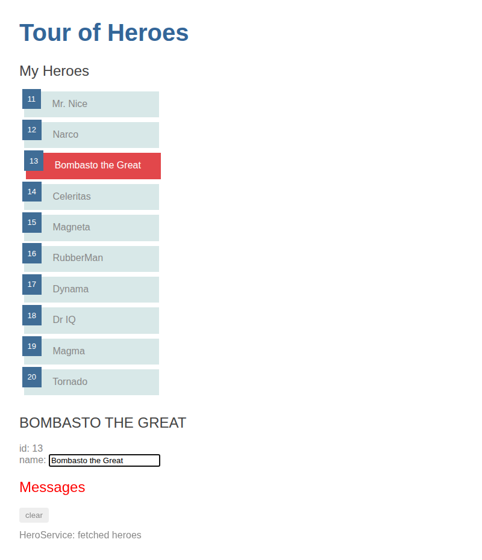

# Tour of Heroes — Angular tutorial

My run through the official Angular [Tour of Heroes](https://v7.angular.io/tutorial) tutorial, steps 1–4
of 8, done on 12 February 2019 with Angular 7.



## What's built

| Step | Commit | What it adds |
|---|---|---|
| 1. The Hero Editor | `bf37ae1` | `HeroesComponent`, two-way binding with `[(ngModel)]`, the `uppercase` pipe |
| 2. Displaying a List | `e958c13` | `*ngFor` over mock heroes, click to select, `[class.selected]` |
| 3. Master/Detail | `ab0c069` | `HeroDetailComponent` with an `@Input()` hero |
| 4. Services | `cf24818` | `HeroService` returning an `Observable`, `MessageService` and the message log |

Not done: routing, the dashboard, HTTP and search (tutorial steps 5–8).

## Run it

Angular 7 needs **Node 10** (newer Node versions fail to build it):

```bash
nvm use            # picks Node 10 from .nvmrc
npm ci
npm start          # http://localhost:4200
npm test -- --watch=false --browsers=ChromeHeadless
```

## Structure

```
src/app/
├── heroes/            # List of heroes, selection
├── hero-detail/       # Edit the selected hero
├── messages/          # Message log
├── hero.service.ts    # Heroes as an Observable
├── message.service.ts
├── mock-heroes.ts
└── hero.ts
```

Made by [Ilya Bielov](https://www.facebook.com/MrBiela).
